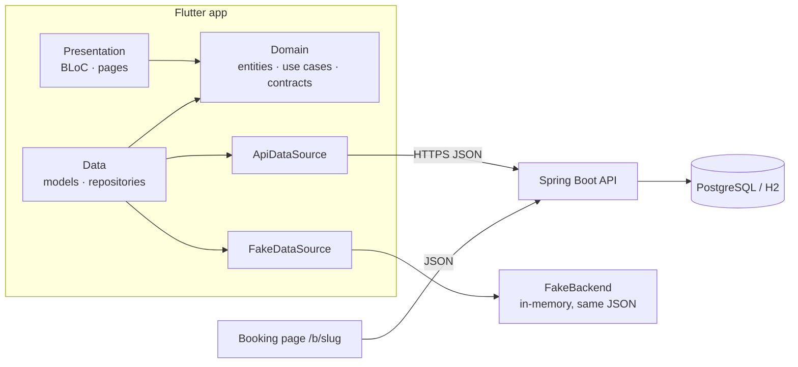

# Architecture

## Two apps, one contract



The API's JSON is the contract (browse it in Swagger at `/docs`). `FakeBackend` returns exactly the same JSON from memory, so the real models, repositories and BLoCs are exercised in the demo too. Nothing in the app above the data layer knows which one is running.

## Flutter: Clean Architecture, feature-first

```
lib/
  config/        AppConfig (dart-defines), Brand (white-label)
  core/          errors, theme tokens, l10n, router, formatters, shared widgets, FakeBackend
  features/
    auth/        phone OTP, demo logins, session
    places/      home, explore, place details
    booking/     slot picker, confirmation, my bookings
    owner/       schedule, status changes, walk-ins, services
    profile/
```

Each feature has `domain/`, `data/` and `presentation/`. The dependency rule is checked in CI by `tool/check_layers.sh`:

- `domain/` is pure Dart: no Flutter, no HTTP, no storage, no data layer.
- `presentation/` never imports data sources or models.

### Error handling

Data sources throw (`ServerException(code)`, `SlotTakenException`, `NetworkException`). Every repository wraps calls in `guard()`, which returns `Either<Failure, T>`. BLoCs fold the Either into state, and `failure.message(l10n)` turns it into Arabic or English. There is no `try/catch` in any screen.

### Patterns that are actually used

| Pattern | Where | Why |
| --- | --- | --- |
| Repository | `BookingRepository` / `BookingRepositoryImpl` | Domain doesn't know where data comes from; API and in-memory are interchangeable |
| Use case (command) | `CreateBooking`, `CancelBooking`, `GetAvailableSlots` | One business action per class; rules like "3 hours before" live here and are unit-tested |
| BLoC (observer) | `BookingBloc`, cubits | Screens rebuild from a stream of states; logic is testable without widgets |
| Dependency injection | `injection_container.dart` (get_it) | Constructors take what they need; tests pass mocks; one switch picks the backend |
| Adapter / mapper | `BookingModel.fromJson`, `PlaceModels` | Wire format in one place |
| Strategy | `AuthDataSource`, `BookingDataSource` … (Api / Fake) | Same interface, different implementation |

SOLID in practice: single responsibility (one use case, one job), dependency inversion (domain owns the interfaces), open/closed (a third data source, e.g. Firebase, can be added without touching the domain or UI).

## Spring Boot API

| Package | Holds |
| --- | --- |
| `scheduling` | `SlotCalculator`: pure Java, no Spring. Working hours in the place's timezone, 15-minute units, staff days off, past slots |
| `booking` | `BookingService` (all booking rules), `SlotLock` (the unique index), controllers for customers, owners and the public page |
| `place` | places, services, staff, reviews, read queries |
| `auth` | OTP (5 min, 5 attempts), HMAC-signed bearer tokens, `TokenAuthFilter`, roles CUSTOMER / OWNER |
| `reminder` | `ReminderJob` every 5 minutes, marks each booking reminded so restarts never send twice |
| `seed` | demo data: 2 salons/spas in Dubai, 2 clinics in Cairo, staff, services, a realistic "today" |

### Booking rules (same in Java and Dart)

1. Start times are on 15-minute boundaries and inside working hours, in the place's timezone.
2. A booking holds `ceil(duration / 15)` units for one real staff member.
3. "Anyone available" = the first staff member who does the service, is not on a day off, and has all units free.
4. Customers may cancel or move until 3 hours before; owners any time.
5. Cancelled and no-show bookings free their units; re-opening one checks the time is still free.
6. Owners only see and change their own place (`AuthUser.placeId`).

### Why a lock table instead of a range query?

A "does anything overlap?" query plus insert has a race: two transactions can both see "free" and both insert. Options:

| Option | Verdict |
| --- | --- |
| `SELECT … FOR UPDATE` on the staff row | Works, but serializes all bookings for a person and depends on isolation settings |
| PostgreSQL exclusion constraint on `tstzrange` | Elegant, but Postgres-only (no H2 for dev/tests) |
| **Unique (staff_id, unit_start) lock rows** | Portable, simple to reason about, the database guarantees it. Chosen |

The cost is a few extra rows per booking (3 for a 45-minute service), which is nothing at clinic/salon scale.

## Time

All instants are stored and sent in UTC. Working hours are wall-clock times at the place; both calculators convert with the place's IANA zone (`Asia/Dubai`, `Africa/Cairo`, which has daylight saving time again since 2023). The app formats every time in the place's zone, so a customer in Cairo booking in Dubai sees Dubai time.
